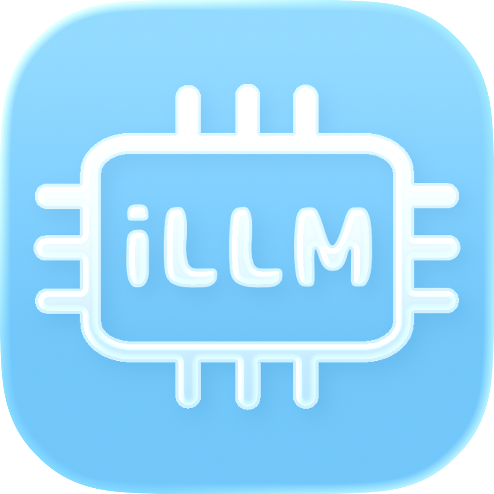

# iLLM
Running a Local LLM on an iPhone / iPhoneでLocal LLMを実行

## How to use / 使い方
**You need to sideload the app. / アプリをサイドロードする必要があります**

Download the IPA file, sideload it, and then run it. / ipaをダウンロードしてサイドロードしてください。そしてそしてそれを実行してください。

### progress / 進捗
- [x] AI behavior / AIの動作
- [ ] Works offline / オフラインで動作
- [ ] ~~Works on iOS 11 / iOS11で動作~~
- [ ] Practical action / 実用的な動作

### others / その他
**I will not make any further corrections other than minor details. / これ以上は細かいところ以外修正しません。**
